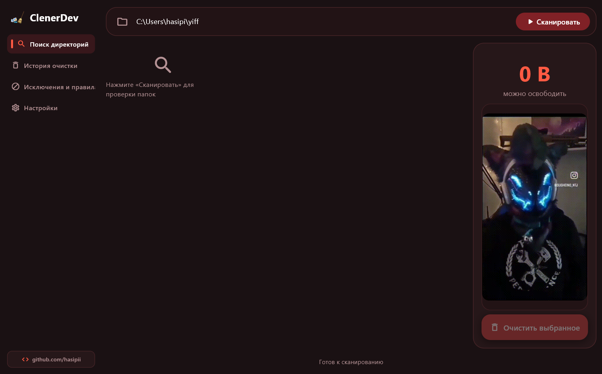

# ClenerDev 🧹

Легковесная и быстрая утилита для разработчиков, которая освобождает гигабайты дискового пространства, вычищая накопившийся мусор: зависимости, временные файлы и тяжелые кэши сборки.



---

### Почему это нужно?

Если вы регулярно пишете код, диск незаметно забивается папками `node_modules`, виртуальными окружениями `.venv`, кэшами `target` в Rust, сборками Gradle, `.next`, `build` и десятками других временных каталогов. 

ClenerDev находит эти залежи за секунды, группирует их по категориям, считает точный размер и позволяет безопасно удалить всё ненужное в один клик. Исходный код проектов при этом под надежной защитой — удаляются исключительно разрешенные папки кэшей.

---

### Главные фичи

- **Быстрое потоковое сканирование:** обход диска работает в фоне, интерфейс летает и не подвисает даже на огромных проектах.
- **Безопасное удаление:** встроенный белый список не позволит случайно стереть файлы репозитория или системные данные.
- **Инспектор проектов:** можно посмотреть список найденных папок внутри каждой категории, отфильтровать их по имени и открыть нужную в проводнике.
- **Подсветка заброшенных репозиториев:** приложение видит дату последнего изменения и выделяет проекты, к которым вы не прикасались месяцами.
- **Кастомизация интерфейса:** 5 цветовых тем (включая темные, светлую и фиолетовые), поддержка русского и английского языков.
- **Живой боковой баннер:** встроенные пресеты анимаций (`mup.gif`) плюс возможность загрузить свою картинку или гифку прямо с компьютера.
- **Сохранение настроек:** все ваши предпочтения и кастомные фоны автоматически сохраняются между перезапусками.

---

### Скачать и запустить

Устанавливать Python и настраивать окружение не требуется.

Перейдите во вкладку [Releases](https://github.com/hasipii/ClenerDev/releases\tag) и скачайте свежую версию:

---

### Запуск из исходного кода

Если вы хотите собрать проект самостоятельно или доработать код под себя:

1. Склонируйте репозиторий:
```bash
git clone [https://github.com/hasipii/clenerdev.git](https://github.com/hasipii/clenerdev.git)
cd clenerdev
